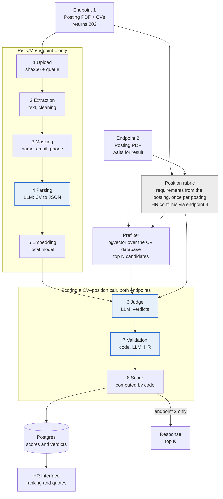
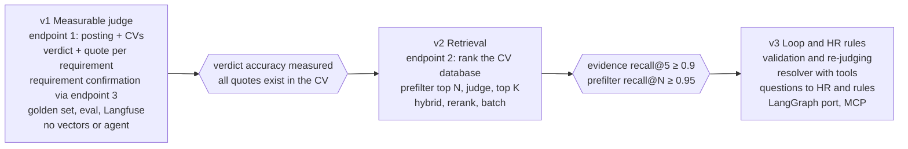

# ATS tool: architecture, agent loop, evaluation and plan v1–v3

Nov 12, 2026 · @Laki · revision Nov 16, 2026: reduced scope

## Summary: what holds up

The application has two ranking endpoints and one endpoint for HR's response. Endpoint 1 ranks the CVs sent along with a job posting and writes the results to the database. Endpoint 2 ranks the CVs already in the database against a new job posting and returns the best ones. Scoring is based only on the posting from the PDF and the CV content, and the same model is used everywhere an LLM is needed. Retrieval and the agent are not forced by context size. The justification is the cost and quota of LLM calls, a CV database that grows over time, and steps whose path cannot be written in advance.

| Part | Verdict | What doesn't hold up | Change |
| --- | --- | --- | --- |
| 1. Ranking submitted CVs (endpoint 1) | Holds, as an asynchronous job | Synchronous response: N CVs with validation take minutes, and the quota limits the call rate. | The API returns 202; scoring goes through the job queue and the results are written to the database. |
| 2. Ranking the CV database (endpoint 2) | Holds, as two-phase ranking | The LLM cannot judge the whole pool. One vector per CV measures topical closeness, not fulfilment of requirements. | An embedding prefilter by requirements picks the top N candidates, the LLM judges only those, and the top K is returned. |
| 3. Validation loop | Partly holds | Self-assessed confidence is poorly calibrated. Most checks are plain code. Re-scoring can break correct verdicts. "Once per position" requires question deduplication and re-scoring of candidates scored earlier. | Code checks plus an isolated verifier. An agent with tools only for flagged requirements. HR's answer becomes a versioned rule that triggers a re-score. |

Here, a vector database means a pgvector column in the Postgres you already have. The agent is justified in one step: resolving flagged verdicts, where it is not known in advance whether more search, an existing rule, or a question to HR is needed.

## 1. Assessment of the three proposals

Retrieval fits two jobs: selecting candidates from the database for the LLM judge, and fetching evidence from the CV. Choosing the criteria itself is not a job for retrieval.

### 1.1 Ranking submitted CVs (endpoint 1)

The criteria are the requirements from the posting. Retrieval as the source of criteria has three flaws.

1. **Completeness.** Scoring needs a verdict for every criterion, and top-k is by definition a subset.
2. **Bias.** If the query is the CV, similarity picks the criteria the CV talks about. Criteria for which the candidate has nothing drop out and the score goes up.
3. **Size.** A 1–2 page posting has 700–1,400 tokens and fits entirely in the prompt.

The correct division of work:

- **Requirements: extraction, once per posting.** The LLM reads the whole posting and returns a complete list of atomic requirements. A requirement that refines another requirement from the same posting ("Java" and "3 years of experience in Java") carries a `parent_id`, so it is not counted twice. HR confirms or edits the list through endpoint 3; scoring does not wait for confirmation (section 2.4).
- **Evidence: retrieval over the CV.** For each criterion, parts of the CV are retrieved, and the verdict must quote them. For a 2-page CV this is optional, because the whole CV fits in the prompt.
- **Flow.** Endpoint 1 returns 202 with a `request_id`, and scores are written to the database as they arrive. There is one assessment per candidate–position pair, so the same CV submitted again with the same posting is not paid for again.

HR sees a ranked list per position, the score, and the verdict with a quote for every requirement.

### 1.2 Ranking the CV database (endpoint 2)

This is two-phase ranking: the posting is the query, and the CVs in the database are the documents.

- **Phase 1, prefilter.** For each candidate, a weighted average of the best requirement–chunk similarities is computed: `Σ wᵢ · maxⱼ cos(requirementᵢ, chunkⱼ) / Σ wᵢ`, where the chunks are that candidate's CV items. The top N candidates (initially 20) go on. The same vectors are used that later serve for evidence.
- **Phase 2, judge.** The same LLM judge and the same validation loop as in endpoint 1, only for the top N. The response returns the top K (initially 10), and all scores are written to the database.
- **Why per requirement.** One vector for the whole CV against one for the whole posting measures topical closeness, not fulfilment of requirements or seniority.
- **Reuse.** A position is recognized by the `sha256` of the posting PDF. A candidate who already has a completed assessment for the same position and the same `rubric_version` does not go to the judge again.
- **Scale.** While the database has up to N candidates, the LLM judges all of them; the prefilter has nothing to save. With 1,000 CVs and N = 20 that is 20 assessments instead of 1,000. The corpus grows here: 1,000 CVs is 10–15 thousand chunks.
- **Synchronicity.** The endpoint waits for the result until the deadline (initially 120 s). If the scores do not arrive in time, it returns a partial ranking with a per-candidate status, and the assessments are completed in the database. On the free quota of 5 requests per minute, the top 20 does not fit within that deadline (section 6.1).

### 1.3 Validation loop

The most valuable part is the question to HR with persistent state and a rule that stays. Five things in the proposal should change.

1. **Confidence.** A number the LLM assigns to itself tracks accuracy poorly. Triggers should be measurable: the quote does not exist in the CV, a verdict without evidence, disagreement between the judge and the verifier.
2. **Who checks.** The schema, quotes, tenure calculation, and contradictions between related requirements are code. The LLM is for two questions: does the quote support the verdict, and is the rule undefined.
3. **Repeating with feedback.** The judge can yield to the critic and change a correct verdict. Only the flagged requirement is judged again, at most two rounds, and fixed is measured against broken.
4. **Once per position.** This needs question deduplication, rule versioning, and re-scoring of candidates scored before the answer. Without it, 20 CVs from the same batch ask the same question 20 times.
5. **Rules in the RAG corpus.** A position will have 5–30 rules, and they go whole into the prompt. Rule retrieval comes when there are more than 50, or when you offer HR a similar rule from another position.

The "score, check, repeat" flow is a workflow with a bounded loop, because code holds the order of steps. An agent in the narrower sense is the resolver of a flagged requirement: the model chooses whether to ask for more evidence, apply an existing rule, or ask HR.

Two additions reduce the number of questions. When a position is created (the first call of endpoint 1 or 2 with that posting), one LLM call lists likely ambiguities (practice counted as tenure, bootcamp as a degree), and HR resolves them in advance. During scoring, a question goes to HR only if the answer can change the shortlist or the status of a mandatory requirement.

### 1.4 At what scale each technique pays off

| Technique | Not needed while | Pays off from |
| --- | --- | --- |
| Embeddings in a pgvector column | – | v2, from day one |
| ANN index (HNSW) | fewer than \~20,000 chunks | \~20,000 chunks for a database search per position, \~100,000 for individual queries |
| Candidate prefilter (endpoint 2) | up to 20 CVs in the database (N = 20) | a database larger than N |
| CV evidence retrieval | CV up to 3 pages, one document | CV over 8 pages, multiple documents per candidate, search over the CV database |
| HR rule retrieval | up to 30 rules per position | 50+ rules or company-level rules |
| Reranker | up to 10 candidates per query | search over thousands of chunks |
| Agent with tools | all checks pass | as soon as a flagged requirement exists; justified by uncertainty of the path, not by volume |

The ANN thresholds were measured on Postgres 16 + pgvector, 2 vCPU, 100,800 vectors of 1024 dimensions. An exact query takes about 65 ms over 10,000 chunks and about 700 ms over 100,000. A database search for one position (12 requirements) over 100,000 chunks takes 8.7 s without an index; with HNSW one query takes about 5 ms.

## 2. Architecture

Three corpora are indexed: CV items, requirements, and HR rules. The posting is not chunked, because requirements are extracted from it and they are the unit.

### 2.0 Endpoints

| Endpoint | Input | Output | From |
| --- | --- | --- | --- |
| 1. `POST /rankings` | posting PDF, one or more CV PDFs | 202 with `request_id`; scores are written to the database | v1 |
| 2. `POST /rankings/search` | posting PDF; optional `top_n` and `top_k` | top K candidates with score, range, status, and quotes; scores are written to the database | v2 |
| 3. `POST /hr/answers` | HR decision: confirmation or edit of a position's requirements, or an answer to an open question | new `rubric_version` or rule, plus `rejudge` jobs | v1 requirement confirmation; v3 questions |

Both ranking endpoints recognize the position by the `sha256` of the posting PDF. A new posting creates a position and a rubric with status `unconfirmed`. The interface and MCP read results through read-only GET endpoints (ranked list per position, assessment with verdicts, open questions); those endpoints do not trigger scoring.

### 2.1 What is indexed

| Corpus | Unit | The vector is used for | From |
| --- | --- | --- | --- |
| CVs | CV item: one job, a degree, a skills list, certificates | evidence, candidate prefilter in endpoint 2 | v2 |
| Posting requirements | one atomic requirement | candidate prefilter and the query for evidence | v2 |
| HR rules | one rule; the situation description is embedded | finding the applicable rule, suggesting an answer from another position | v3 |
| Questions to HR | situation description | question deduplication | v3 |

### 2.2 Chunking

Splitting by logical units is correct. What changes is how the units are obtained and what is embedded.

- **Units come from structured extraction, not from cutting text.** One LLM call turns the CV into JSON: experience, education, skills, certificates, languages, projects. Text from a PDF has no reliable section boundaries, because two-column templates and tables scramble the order.
- **Each item carries a verbatim snippet of the source text.** Code finds its position in `raw_text`. If the items cover less than 85% of the text, the document is flagged and falls back to paragraph splitting (about 300 tokens, 15% overlap).
- **A chunk gets a context header before embedding.** Example: "Work experience | Project Manager, bank | 2019-03 to 2023-06 (51 months)". Without the header, the sentence "led a team of 8 people" loses its role and period.
- **Duration is computed by code.** Months per item and total tenure, merging overlapping periods, go to the judge as ready-made facts. LLMs make mistakes in date arithmetic.
- **The skills list is one chunk and a `skills[]` array.** Postgres text search reduces "C#", "C++", and "C" to the same token `c`, and "Node.js" does not match "node". Skills are therefore normalized through an alias table and searched as an array.
- **A requirement is atomic.** "A degree and 3 years of experience" become two requirements already at extraction.

Serbian needs normalization before lexical search: Cyrillic to Latin, lowercase, đ to dj, stripping diacritics. That way "вођење", "vođenje", and "vodjenje" yield the same form; verified on test examples. The embedding is computed over the original text: the authors of the Serbian model [Embedić](https://huggingface.co/djovak/embedic-large/blob/main/README.md) state that Latin script without diacritics significantly degrades search.

### 2.3 Metadata per chunk

| Field | Purpose |
| --- | --- |
| `candidate_id` | filter before search; evidence is searched only in one candidate's CV, while the endpoint 2 prefilter goes across all candidates |
| `section_type`, `seq` | filter by section, display, fetching neighboring chunks |
| `char_start`, `char_end` | highlighting quotes in the interface and checking quotes against `raw_text` |
| `date_from`, `date_to`, `months` | tenure computed by code |
| `skills[]` | exact skill matching |
| `text_norm`, `tsv` | lexical branch of hybrid search |
| `lang`, `script` | metrics broken down by language and script |
| `content_hash` | re-upload creates no duplicates and does not re-embed |
| `embedding_model` | reindexing when the model changes; vectors of two models are not mixed in the same search |
| `token_count` | context budget |

### 2.4 Data flow

**The LLM is called in three steps per CV and once per posting; everything else is local code.**

Steps 4, 6, and 7 call the LLM and receive only masked text. The position rubric is prepared once and enters the endpoint 2 prefilter and the judge's prompt. All LLM calls go to the same model (section 6.1).

Position setup, once per posting:

1. Endpoint 1 or 2 receives the posting PDF. If the `sha256` finds an existing position, its rubric and rules are used, and steps 2–4 are skipped.
2. Text extraction from the posting, same as for a CV, without masking.
3. The LLM extracts the requirements and a list of likely ambiguities. The rubric gets status `unconfirmed`, and the ambiguities become open questions to HR (from v3).
4. The requirements are embedded locally.
5. HR confirms or edits the requirements through endpoint 3. Confirmation changes the status to `confirmed`. An edit increases `rubric_version` and enqueues `rejudge` jobs for that position's assessments. Until confirmation, the assessment carries the label "rubric unconfirmed".

Per CV (endpoint 1):

1. **Upload.** The file is stored, `sha256` catches a duplicate, the API returns 202, and the job goes into the queue.
2. **Text extraction.** A scanned PDF is rejected with a message. Hidden text is removed and logged. Invisible Unicode characters are deleted. Language and script are determined.
3. **Masking of personal data.** Name, email, phone, and address are replaced with placeholders; the original stays in the `candidate` table.
4. **Triage and parsing.** One LLM call: is the document a CV, structured JSON, suspected injection.
5. **Chunking and embedding.** Local, no LLM call.
6. **Judge.** One LLM call per CV–position pair returns a verdict and a verbatim quote for each requirement.
7. **Validation.** Code checks, the verifier, and if needed the resolver and a question to HR (section 3).
8. **Score.** Computed by code, not by the LLM.

Per endpoint 2 call:

1. The prefilter over CVs that have already passed steps 1–5 picks the top N candidates (section 1.2).
2. Candidates without a completed assessment for the current `rubric_version` go through steps 6–8.
3. The response returns the top K, ordered as in the interface: first candidates with no failed mandatory requirements, then by score. A score waiting on HR is ranked by the lower bound of its range.

Score formula: met = 1, partial = 0.5, not\_met = 0. Coverage is `Σ wᵢ·sᵢ / Σ wᵢ`, separately for mandatory and nice-to-have requirements. The initial formula is `100 × (0.7 × mandatory + 0.3 × nice-to-have)`. A failed mandatory requirement carries a flag, and the candidate goes below those without one. While some verdict is waiting for HR, a range from the worst to the best outcome is shown.

### 2.5 Table schemas

Thirteen tables; full DDL and queries are in the Schemas and queries (SQL) tab.

| Table | Purpose |
| --- | --- |
| `job_position` | position, posting text, `source_sha256`, `rubric_version`, `rubric_status` |
| `requirement` | requirements from the posting, with vector and `parent_id` |
| `candidate` | personal data, separated from everything that goes to the LLM |
| `document` | CV or posting PDF: source text, masked text (CV only), parsed JSON, flags |
| `chunk` | CV chunks: text, normalized text, `tsvector`, vector, metadata |
| `ranking_request` | one call of endpoint 1 or 2: type, position, status, `top_n`, `top_k` |
| `request_candidate` | candidates of one call: a CV submitted through endpoint 1 or chosen by the endpoint 2 prefilter, with the prefilter score |
| `assessment` | one assessment per candidate–position pair: status, scores, range, cost, trace |
| `verdict` | verdict per requirement; append-only, one current |
| `hr_question` | question to HR with a vector for deduplication |
| `question_waiter` | which verdicts wait for which question |
| `hr_rule` | rule from HR's answer: scope, version, status |
| `task_queue` | job queue in Postgres (`FOR UPDATE SKIP LOCKED`) |

## 3. Agent loop

The loop has seven states and at most two rounds of re-judging. No process waits for HR: waiting is a queue in the database.

### 3.1 States

The state diagram stays the same: 7 states, 1 loop, at most two rounds of re-judging, waiting for HR is a queue in the database.

A verdict that fails a check goes to the resolver. It either sends it back to the judge, sends a question to HR, or, when its budget is spent, hands it to HR for a manual decision.

| State | What happens | Next |
| --- | --- | --- |
| `queued` | the job waits for a worker | `judging` |
| `judging` | the judge scores all requirements (round 0) or only flagged ones (rounds 1–2) | `validating` |
| `validating` | code checks, then the verifier | `final` with no flags; `resolving` with flags; `needs_review` when the budget is spent |
| `resolving` | the resolver with tools works on flagged requirements | `judging`, `waiting_hr`, or `needs_review` |
| `waiting_hr` | at least one verdict waits for a question; the score is published as a range | `judging` when the answer arrives |
| `final` | all verdicts passed the checks | `judging` if a rule or the rubric changes |
| `needs_review` | budget spent or no progress; HR sees the reason | manual decision |

A technical error after three attempts leads to `failed`.

### 3.2 Triggers

| Check | Who does it | Flag |
| --- | --- | --- |
| Every requirement has exactly one verdict | code | judge is called again |
| The quote exists in `raw_text`: verbatim after normalization or fuzzy ≥ 90; numbers from the quote must exist verbatim | code | `quote_not_found` |
| `met` or `partial` without a quote | code | `no_evidence` |
| Requirement with `min_months` against computed tenure | code | `duration_mismatch` |
| Related requirements (`parent_id`) with incompatible verdicts | code | `contradiction` |
| Does the quote support the verdict; the verifier sees only the requirement, the quotes, and the computed facts | same model, in a separate call without the judge's reasoning | `not_supported` |
| The judge reports a situation the requirement does not define | judge, `needs_rule` field | `needs_rule` |

The `needs_rule` field replaces confidence: the judge does not rate how sure it is, but describes the situation the rule does not cover.

### 3.3 Resolver tools

| Tool | What it does |
| --- | --- |
| `search_cv(query, section?)` | hybrid search over that candidate's chunks; second query, synonyms, another language |
| `get_cv_section(section_type)` | the full text of one section |
| `compute_experience(keywords[])` | months of tenure on items that mention the keywords; deterministic |
| `search_rules(situation)` | active rules of the position and the company, ranked |
| `find_similar_rulings(situation)` | rules of other positions, as a suggested answer for HR |
| `ask_hr(requirement_id, situation, options[])` | creates a question or attaches to an existing one; ends work on the requirement |
| `submit_verdict(requirement_id, verdict, evidence[])` | ends work on the requirement; the verdict goes through the checks again |

The candidate and the position are bound by the orchestrator, not by an argument the model chooses, so the resolver cannot read other people's data. `ask_hr` takes structured fields and the question is assembled from a template, so text from the CV does not reach HR as an instruction.

### 3.4 Stopping conditions

- At most 2 rounds of re-judging per assessment.
- At most 4 tool calls per requirement and 12 per assessment.
- A budget of 30,000 tokens per assessment as the starting value.
- No progress: the same check fails twice for the same requirement.
- At most 5 open questions per position. Beyond that, `partial` is applied and the assumption is recorded in the rationale.
- A question is asked only if the outcome can change the shortlist or the status of a mandatory requirement.

Every stop leaves a flag on the requirement and leads to `needs_review`. Nothing is accepted silently.

### 3.5 Pause and resume

1. `ask_hr`, under an advisory lock, looks for a similar question for the same position–requirement pair. If one exists, the verdict is just written into `question_waiter`.
2. The verdict gets `pending_hr`, the assessment moves to `waiting_hr` with a range, and the worker takes the next job.
3. HR answers through endpoint 3, from the interface or an MCP client. One transaction writes the rule, closes the question, increases `rubric_version`, and enqueues `rejudge` jobs for everyone waiting and for earlier completed assessments of the same position.
4. `rejudge` judges only that requirement, with the rule in the prompt, and records `applied_rule_ids`.
5. A rule edit creates a new version with `supersedes`, the old one becomes `superseded`, and step 3 repeats.

A repeated click and a repeated job are harmless thanks to `dedup_key`. A job that stays in the `running` state too long goes back to the queue. A position's rule takes precedence over a company rule, and a newer version over an older one.

### 3.6 By hand or LangGraph

Write the loop by hand first, then port the same flow to LangGraph as the last phase of v3.

Reasons for the manual version first:

- The hard part is the data model: one question wakes N assessments, rules have versions, old assessments are re-judged. That stays your job even with a framework.
- The manual version is 200–300 lines: a state enum, a transition table, a function per state, a job queue.
- You will see what the checkpointer and interrupt abstract away.

How the flow maps to LangGraph:

- One thread per assessment, states become nodes, and `PostgresSaver` from the `langgraph-checkpoint-postgres` package stores the checkpoint; [`setup()`](https://reference.langchain.com/python/langgraph.checkpoint.postgres/PostgresSaver/setup) creates its own tables.
- The `ask_hr` node calls `interrupt()`, and resuming is [`Command(resume=...)`](https://docs.langchain.com/oss/python/langgraph/human-in-the-loop) for each thread from `question_waiter`.
- Trap: on resume the node [executes from the beginning](https://docs.langchain.com/oss/javascript/langgraph/interrupts/index.html). Everything before `interrupt()` must be idempotent, so question creation goes into a separate node or an upsert.
- The resolver becomes `create_agent` from `langchain.agents` with the same tools and the same Gemini model through `langchain-google-genai`.

If you skip the port, at least build the resolver in LangGraph, so you have the framework in your hands.

## 4. Where the other concepts fit

Hybrid search, triage, and guardrails fit naturally. MCP fits only as an external interface, and n8n only at the edges of the system.

### 4.1 Hybrid search and reranking

A CV is a data type that needs hybrid. Skills are exact tokens (SAP, PL/SQL, PMP, K8s) that a dense vector blurs. Paraphrases and two-language pairs ("upravljanje projektima" and "project management") need dense. CVs written without diacritics embed worse, and the lexical branch works over normalized text.

- **Where.** Evidence within a CV (the `search_cv` tool), the candidate database search in endpoint 2, and rules.
- **Lexical branch.** Postgres has a built-in `serbian` configuration with a stemmer that also reduces Cyrillic to Latin: "пројектима" and "projekta" both give `projekt`. Verified on Postgres 16.
- **Fusion.** Reciprocal Rank Fusion with k = 60, in one SQL query.
- **Upgrade.** [pg\_textsearch](https://www.tigerdata.com/docs/deploy/tiger-cloud/tiger-cloud-extensions/pg-textsearch) brings real BM25 for Postgres 17 and 18. Introduce it as one more variant in the ablation, not up front.
- **Reranker.** A cross-encoder over the top 20–30 from fusion returns the top 5. It pays off for the database search in endpoint 2. Within a single CV of about ten chunks there is nothing for it to reorder.
- **Proof it's worth it.** An ablation table: dense, lexical, hybrid, hybrid + rerank, on evidence recall@5, broken down by language and script. Whatever does not raise the number leaves the pipeline.

### 4.2 Triage of incoming CVs

Triage determines what happens next with a document and never rejects a candidate because of content.

- **Is the document a CV.** The same model, in the same call as parsing.
- **Language and script.** The language detector labels Serbian Latin as Bosnian or Croatian; verified with the lingua library. Serbian, Croatian, and Bosnian are therefore treated as one class, and the script is determined by Unicode range.
- **Scanned PDF.** Too few characters per page means rejection with a clear message.
- **Hidden text and suspected injection.** A flag for HR.

### 4.3 MCP server

MCP does not sit between your orchestrator and your tools in the same process. A direct function call is shorter, faster, and easier to test.

It sits as a second interface over the same service layer, next to REST. An MCP client (Claude Desktop, Claude Code, MCP Inspector) then queries the ATS: `list_positions`, `top_candidates`, `get_assessment`, `explain_verdict`, `search_candidates` (the same as endpoint 2), `list_open_questions`, `answer_question` (the same as endpoint 3). HR gets questions like "who is the top 5 for BA and why is X above Y" without a chat interface, and you get an overview of eval failures from Claude Code.

Risk: a tool result carries text from the CV into an agent that has broader privileges than your judge. Tools return structured fields and quotes marked as data, and only `answer_question` writes. The official Python SDK is `mcp` version 2; [v2](https://newreleases.io/project/github/modelcontextprotocol/python-sdk/release/v2.0.0) serves clients over Streamable HTTP and stdio from the same `MCPServer` class.

### 4.4 Guardrails against prompt injection through the CV

A CV is untrusted input read by an LLM, so this is the most natural security concept in the project. A [study of 196,682 real CVs](https://arxiv.org/pdf/2605.28999) found hidden inserts in about 1% of documents. Over 90% of those inserts were hidden data, most often skills lists, rather than instructions to the model.

| Layer | Measure |
| --- | --- |
| Extraction | Drop a span whose color is close to the background, whose font is below 4 pt, that is outside the page, or in an invisible render mode. Additional check: if the span's region is a single color on the rendered page, the text is not visible. |
| Unicode | Delete characters of categories Cf, Co, and Cn (zero-width, bidi, tag characters). A word with mixed Cyrillic and Latin letters is a homoglyph signal. |
| Channel separation | The CV goes in a fenced data block, and the system message says the block's content is inert. |
| Architecture | The judge has no tools. The output is a schema with an enum verdict and a quote. Code computes the score. The verifier sees only the requirement and the quotes, so an instruction outside the quotes never reaches it. |
| Hidden skills lists | A skill that exists only in a list, without confirmation in experience, gives at most `partial`. |
| Persistence | Only text written by HR enters the rules. Text from a CV never becomes a rule. |
| Detection | Regex in Serbian and English plus an optional [Llama Prompt Guard 2](https://docs.mozilla.ai/any-guardrail/api-reference/index/prompt-injection/prompt-guard) classifier. The flag goes to HR. |
| Measurement | Pairs of a clean CV and the same CV with an attack. The metric is the share of attacks that change a verdict or a score. |

The extraction layer was verified on a test PDF with five kinds of hidden text. Plain `page.get_text()` in PyMuPDF returns white, tiny, and invisible text as normal. Color and size from `get_text("dict")`, type from `get_texttrace()`, and a render check together catch all five.

Channel separation is the measure with the best cost-to-effect ratio. On the synthetic [ResumeShield](https://arxiv.org/pdf/2609.20188) set of 104 documents, separation alone dropped the attack success rate from 100% to 0%, while filtering alone left 16.7%. The set is small and synthetic, so use it as initial red-team material, not as proof. There is no data on Prompt Guard for Serbian, so measure it before you trust it.

### 4.5 Other concepts from the job posting description

| Concept | Where it fits |
| --- | --- |
| Prompt caching | A stable prefix (instructions, rubric, rules) goes first, the CV last. CVs of the same position are processed in sequence. |
| Batch processing | Importing 100+ CVs through endpoint 1 and a job queue with rate limiting. Re-score after a rule or rubric change. |
| Cost and latency | Prefilter in endpoint 2, code checks before the LLM verifier, the loop only for flagged requirements, `thinking_level` per role. Cost per CV and p95 per step in Langfuse. |
| Structured outputs | Every LLM output is a Pydantic schema. Invalid output means one retry call, then `failed`. |
| n8n | Only at the edges: receiving CVs from email or a folder (calls endpoint 1) and notifying HR of a new question. The logic stays in Python, because the eval harness calls it directly. |
| LangChain, LlamaIndex | Not needed for retrieval; SQL queries are shorter and easier to measure. LangGraph enters in v3. |

n8n is not open source in the OSI sense. The license is the [Sustainable Use License](https://docs.n8n.io/n8n-community-license/sustainable-use-license), which allows internal use and self-hosting.

## 5. Evaluation

The golden set is built so that labels are known by construction: first a candidate profile with predefined outcomes, then a CV generated from the profile.

### 5.1 Golden dataset

Common basis:

- **6 positions with deliberate overlap.** For example: project manager, business analyst, data analyst, backend developer, financial controller, sales manager. Each has a posting PDF with 8–12 requirements. The overlap gives endpoint 2 close but wrong candidates.
- **60–90 CVs from profiles.** For each requirement of the target position, the profile specifies a verdict and the fact that proves it, plus a relevance of 0–3 for all 6 positions. The CV is preferably generated by a different model from the one that judges; the generator is a tool for building the set, not part of the application.
- **Distribution.** 40% Serbian Latin (half without diacritics), 20% Cyrillic, 30% English, 10% mixed. Single-column PDF and two-column PDF.
- **Manual check of a 20% sample.** The generator does not always follow the profile.
- **15–20 hand-written hard cases.** Implicit evidence, tenure from overlapping periods, "basic knowledge", a skill only in a list, a course in progress, a career change.
- **10–15 real CVs with consent.** They serve only to measure the gap between synthetic and real and do not go to the free Gemini.
- **Dev 70% and test 30% split.** Prompts are tuned on the dev part, and the numbers are published from the test part.

Synthetic CVs are cleaner than real ones, and an LLM judging LLM-written text gives optimistic numbers. Hard cases and real CVs correct for this.

| Proposal | Gold label | Size |
| --- | --- | --- |
| 1. Ranking submitted CVs (endpoint 1) | manual list of requirements per posting; verdict and quote span per CV–requirement pair | 6 postings, about 800 verdicts |
| 2. Ranking the CV database (endpoint 2) | relevance 0–3 for each CV–position pair | 60–90 CVs × 6 positions |
| 3. Loop | assessments with planted errors (fabricated quote, verdict without evidence, contradiction, wrong tenure); 30–40 cases of an undefined rule with the expected action and question topic; the same case in another language and script | about 150 cases |
| Injection | pairs of a clean CV and the same CV with an attack | 20–30 pairs |

### 5.2 Metrics

| What is measured | Metric |
| --- | --- |
| Verdict accuracy | accuracy and macro-F1 over three classes, confusion matrix, weighted kappa because the classes are ordinal |
| Groundedness | share of verdicts whose quote exists in the CV; match of the quote with the gold span |
| Evidence retrieval | recall@5 and MRR; recall matters more, because the judge tolerates excess, not shortage |
| Candidate prefilter (endpoint 2) | recall@N: share of candidates with relevance ≥ 2 that enter the top N, measured separately from the final rank |
| Candidate rank per position | NDCG@10, precision@5 with relevance ≥ 2, Kendall tau against the gold rank |
| Requirement extraction | precision, recall, F1; accuracy of the mandatory or nice-to-have label |
| Validator | precision and recall over planted errors |
| Injection | share of attacks that change a verdict or a score |
| Cost and speed | tokens and dollars per CV, p50 and p95 per step, alongside every quality table |

The usefulness of questions to HR is measured with five numbers:

- **Necessity.** Share of asked questions that match the gold ambiguities.
- **Coverage.** Share of gold ambiguities for which a question was asked.
- **Duplicates.** The same ambiguity asked more than once per position; the target is 0.
- **Impact.** Number of verdicts and top-5 changes that depend on the answer. A question none of whose answers changes the rank was unnecessary.
- **Reuse.** Number of later verdicts resolved by a rule without a new question, including the same case in another language or script.

### 5.3 Does the loop improve the scores

Four variants on the same test set:

| Variant | What it does |
| --- | --- |
| A | a single judge pass |
| B | A + code checks |
| C | B + verifier, re-judging, and resolver |
| D | control: three judge passes and majority vote, with about the same number of tokens as C |

For each variant, accuracy and macro-F1 are recorded, and relative to variant A also the verdict changes: fixed (incorrect to correct), broken (correct to incorrect), and lateral. From that follow the net gain (fixed minus broken), tokens per net fixed verdict, and the share of assessments that enter the loop.

Decision rules:

- C must beat D at the same budget. If it does not, the loop is an expensive majority vote and variant B stays.
- If there are as many broken as fixed, the problem is the verifier. The loop is narrowed to failed quotes.
- If over 40% of assessments enter the loop and the net gain is a couple of percent, the checks are oversensitive.
- If the second round brings less than a fifth of the first round's fixes, one round stays.

The comparison is paired, on the same items: a McNemar test or a bootstrap interval for the accuracy difference. Each variant is run three times, because an LLM is not deterministic even at temperature 0. The test part has about 250 verdicts (30% of about 800). At that size a difference of three percentage points is probably not significant, so the conclusion is drawn from the bootstrap interval, not from the difference of means. For a narrower interval, add CVs or hard cases to the test part.

The verifier is the same model as the judge, so it shares its blind spots. That makes the C versus D comparison even more important here.

### 5.4 Harness

- One command (`make eval VARIANT=C`) loads the JSONL, calls the pipeline functions directly, computes the metrics, and writes the result with `pipeline_version`.
- Results also go to Langfuse as a dataset and an experiment, so two runs can be compared per item.
- LLM responses are cached by the hash of the model, prompt, and parameters. An unchanged step is not paid for again.
- CI on every PR runs 20 cases from the cache and fails if accuracy or quote validity drops below the threshold. The full eval is run manually.

## 6. Concrete local stack

Everything except the LLM calls runs locally in Docker Compose, on a machine with 12 GB of RAM. All LLM calls go to a single model, Gemini 3.8 Flash. Its free quota is about 20 requests per day, which covers manual trials but not eval or batch. On the paid tier, the LLM for the whole project costs, by a rough estimate, $30–80, mostly for eval runs.

### 6.1 LLM model

| Role | Model | Why |
| --- | --- | --- |
| All roles: requirement extraction, triage and parsing, judge, verifier, resolver | Gemini 3.8 Flash (`gemini-3.8-flash`) | $0.75 input and $3.75 output per million tokens, [introductory price until December 31, 2026](https://benchlm.ai/google/api-pricing); structured outputs and function calling; context of about 1 million tokens |

Free Gemini quota, according to [user measurements from November 11, 2026](https://www.aifreeapi.com/en/posts/google-gemini-api-free-tier); Google does not publish it, so read yours in AI Studio:

| Model | Requests per minute | Requests per day |
| --- | --- | --- |
| Gemini 3.8 Flash, 3.6 Flash | 5 | 20 |

What follows from this:

- **The free tier is for manual trials.** 20 requests per day is about 6 CVs through endpoint 1 (parsing, judge, verifier). An eval run, importing 100 CVs, and endpoint 2 with N = 20 require the paid tier.
- **5 requests per minute.** Rate limiting in `LLMClient` is mandatory from v1. Endpoint 2 on the free tier does not reach the top 20 within 120 s; for manual trials, lower `top_n` to 3.
- **Only synthetic CVs go to the free tier.** Google uses content sent to free services for product development and reviewers may read it. Real CVs go to the paid tier.
- **Cost on the paid tier.** One judge call is about 4,000 input tokens and 1,500 output tokens, so about $0.0086. A thousand assessments cost about $8.6 for the judge alone, without thinking tokens; with parsing and the verifier about three times more. After December 31, 2026, check the price.
- **Thinking.** Gemini 3 models choose reasoning depth with the `thinking_level` parameter (minimal, low, medium, high), and [thinking tokens are billed as output](https://ai.google.dev/gemini-api/docs/generate-content/whats-new-gemini-3.5). The default level depends on the version, so set it explicitly: `minimal` for extraction and parsing, `low` for the judge and the verifier. Use the eval to check whether `medium` brings anything.
- **Function calling.** Goes through `google-genai`. In a multi-step tool call, the response carries a thought signature that must be returned unchanged; the SDK does this itself, while a hand-assembled REST call without the signature returns a 400 error.
- **Cache and batch.** Cached input costs 10% of the price, and Batch is half price, which suits re-scoring and eval runs.
- **Replaceability.** A thin `LLMClient` interface with one adapter (`google-genai`); the model and key are in configuration (`LLM_MODEL`, `LLM_API_KEY`). Swapping the model to compare quality is a configuration change, and another provider is one more adapter behind the same interface.

### 6.2 Embedding and reranker

The default embedding model is `BAAI/bge-m3`: multilingual, 8,192-token window, MIT license, 1024 dimensions, dense and sparse output from the same model.

For an A/B on your golden set, both with 1024 dimensions, so they fit in the same column:

- `Qwen/Qwen3-Embedding-0.6B`: 64.33 on MTEB Multilingual v2 according to a [comparison from October 2026](https://regolo.ai/embeddinggemma-2-vs-qwen3-embedding-benchmarks.md), context 32,000 tokens.
- `djovak/embedic-large`: multilingual-e5 fine-tuned for Serbian, both scripts, also understands English; the limit is 512 tokens.

Choose by recall@5 on your own set, broken down by script, not by a public leaderboard. The reranker is `BAAI/bge-reranker-v2-m3`, with `Qwen3-Reranker-0.6B` as an alternative. Both models are run by `sentence-transformers` in the worker process; a CPU is enough for hundreds of CVs. All listed models have about 0.6 billion parameters, so each takes about 2.3 GB of RAM in fp32. They are loaded only in the worker, not in the API process.

### 6.3 The rest of the stack

| Layer | Choice | Note |
| --- | --- | --- |
| API | Python 3.12+, FastAPI, Pydantic v2 | REST (endpoints 1–3 and read GETs), and in v3 also MCP over the same service layer |
| Database | Postgres 17 + pgvector, psycopg 3, Alembic | raw SQL for search |
| Job queue | `task_queue` table and a worker process | no Redis or Celery |
| PDF | PyMuPDF | PyMuPDF is under the AGPL license; a closed commercial product needs a replacement or a license |
| Serbian | `cyrtranslit`, custom normalization, `lingua-language-detector` | tried on test examples |
| Quote checking | `rapidfuzz` | threshold 90, calibrate on the golden set |
| LLM client | `google-genai` | one adapter behind `LLMClient`; no LangChain in v1 and v2 |
| Loop orchestration | manual, then `langgraph`, `langgraph-checkpoint-postgres`, and `langchain-google-genai` | v3 |
| Observability and eval | Langfuse self-host, Python SDK with `@observe`, datasets and experiments | [six services](https://railway.com/deploy/langfuse): web, worker, Postgres, ClickHouse, Redis, MinIO; minimum 4 GB of RAM, recommended 8–16 GB |
| Metrics | `scikit-learn`, `scipy`, `statsmodels` | NDCG, kappa, McNemar |
| MCP | package `mcp` version 2 | v3 |
| Frontend | React, TypeScript, Vite, TanStack Query and Table | ranking table, quote display, requirement confirmation |
| Infrastructure | Docker Compose: postgres, api, worker, web, langfuse; optionally n8n |  |
| CI | GitHub Actions: ruff, pyright, pytest, smoke eval from cache |  |
| Development | Claude Code: CLAUDE.md for project conventions, a hook that runs ruff and pytest, a sub-agent for reviewing eval failures | [CLAUDE.md is persistent context, hooks are automation, sub-agents are isolation](https://code.claude.com/docs/en/features-overview) |

RAM budget for 12 GB, an estimate to verify with `docker stats`:

| Service | RAM |
| --- | --- |
| Postgres 17 + pgvector, `shared_buffers` 512 MB | about 1 GB |
| API, without models | about 0.3 GB |
| Worker with bge-m3 | about 2.5 GB |
| Reranker in the worker | another about 2.3 GB |
| Langfuse, six services | at least 4 GB |
| Web, Vite dev server | about 0.5 GB |
| OS, Docker, editor, browser | 3–4 GB |

All together this is over 12 GB, so three rules apply:

- The embedding model and the reranker live only in the worker. Endpoint 2 puts a job in the queue and waits for the result, instead of the API loading a second copy of the model.
- Langfuse and the reranker do not run at the same time. Langfuse is turned on when you measure, and the reranker only once the phase 2.2 ablation shows a gain.
- If Docker runs through a virtual machine (Docker Desktop, WSL2), limit its memory so the OS stays usable.

## 7. Plan from v1 to v3

v1 is a measurable judge without vectors for endpoint 1, v2 adds retrieval and endpoint 2, v3 adds the loop, questions to HR, and MCP. You move to the next version only when the previous one's eval passes. The thresholds are initial targets; calibrate them after the first measurement.

**You move to the next version only when the previous one's eval passes.**

The gates are the thresholds from the phase tables. If a threshold is not met, you stay in the same version and fix the pipeline; new features wait.

### v1: endpoint 1, measurable

**Works:** HR sends the posting PDF and CVs to endpoint 1 and confirms the extracted requirements through endpoint 3. They get a ranked list with a verdict and a quote for every requirement.

**Introduces concepts:** structured outputs, prompt and context engineering, document processing, grounding through quotes, evaluation, LLMOps, REST, Docker, SQL, basic triage, basic guardrails, prompt caching, CI.

| Phase | What is built | Done when |
| --- | --- | --- |
| 1.1 Skeleton | Compose (postgres, api, worker, web), migrations, endpoint 1 with a job queue, text extraction, script normalization | A PDF in Latin, Cyrillic, and English yields clean text in the database; a scanned PDF is rejected with a message; endpoint 1 returns 202, and the result appears in the database |
| 1.2 Requirements | requirement extraction from the posting PDF with `parent_id`, an edit and confirm screen, endpoint 3 for confirmation | extraction F1 ≥ 0.85 on the 6 golden postings; editing requirements re-scores that position's CVs |
| 1.3 Golden set and harness | profiles, generated CVs, JSONL, `make eval` | one command prints a metrics table; a 20% sample is manually checked |
| 1.4 Judge and score | CV parsing, tenure computation, judge, quote checking, formula, `LLMClient` with rate limiting and retry on error 429 | verdict accuracy on the test part is measured and recorded as a baseline, with a target of ≥ 80%; every displayed quote exists in the CV |
| 1.5 Interface | ranked list per position, verdicts with the highlighted quote | every verdict can be checked without opening the PDF |
| 1.6 Observability | Langfuse trace per assessment, prompt versions, cost | for every assessment the prompt, tokens, cost, and latency are visible; cost per CV and p95 are known |
| 1.7 Guardrails and CI | hidden text and Unicode cleaning, channel separation, 20 red-team pairs, GitHub Actions | no attack changes the score, or the exception is explained; CI fails when the smoke eval fails |

**Refactor before v2:**

- The judge receives a `ContextPack` from the function `build_context()`. In v1 it returns the whole CV, and in v2 only it changes. Introduce it already in v1.
- `document` keeps `raw_text` from v1, so CVs uploaded in v1 are chunked and embedded in v2 without re-uploading.

### v2: retrieval and endpoint 2

**Adds:** endpoint 2, which ranks CVs from the database against a posting, evidence retrieval, and importing multiple CVs at once.

**Introduces concepts:** embeddings and vector database, chunking, search/retrieval/ranking, hybrid search, reranking, RAG with source citation, batch processing, precision@k and NDCG.

| Phase | What is built | Done when |
| --- | --- | --- |
| 2.1 Chunking and embeddings | `chunk` table, local model, idempotent ingest, backfill of CVs from v1 | re-upload creates no duplicates; changing the model is a configuration change and one reindex command; all CVs in the database have chunks |
| 2.2 Evidence retrieval | dense, lexical, hybrid, rerank; ablation | the ablation table exists; the chosen variant has recall@5 ≥ 0.9; no script lags by more than 5 points |
| 2.3 Endpoint 2 | prefilter, judge for the top N, response with top K, reuse of assessments for the same `rubric_version` | prefilter recall@N ≥ 0.95; NDCG@10 is measured; at most N judge calls per endpoint call |
| 2.4 Batch | import through endpoint 1 and a job queue, rate limiting | importing 100 CVs runs unattended within the paid-tier quotas; a killed worker resumes without a lost job |
| 2.5 HNSW experiment | exact search versus HNSW for the prefilter | it is measured at how many chunks HNSW beats exact search on your machine |

**Refactor before v3:**

- `verdict` becomes append-only, with `iteration` and `is_current`.
- `assessment` gets a state machine and a score range.
- The tables `hr_question`, `question_waiter`, and `hr_rule` arrive, and the judge's prompt gets a place for rules. Besides requirement confirmation, endpoint 3 also accepts an answer to a question.
- The service layer is extracted, so REST, the resolver tools, and MCP can call it.

### v3: validation, questions to HR, rules, MCP

**Adds:** automatic verdict checking, re-judging, a resolver with tools, questions to HR once per position, versioned rules and re-score, access through MCP, and notifications.

**Introduces concepts:** agents and agentic loops, tool calling, human-in-the-loop, LangGraph, MCP, full guardrails, rules as memory, loop evaluation.

| Phase | What is built | Done when |
| --- | --- | --- |
| 3.1 Code validator | checks, flags, a set of planted errors | validator precision and recall are measured; variants A and B compared |
| 3.2 Verifier and re-judging | isolated verifier, at most 2 rounds | A/B/C/D table with net gain and cost; the decision is recorded: keep, narrow, or drop |
| 3.3 Questions and rules | state machine, deduplication, re-score, versions, answer through endpoint 3 | 20 CVs with the same ambiguity yield exactly 1 question; after the answer all 20 are judged without a manual step; the 21st CV in another script does not open a question; a rule edit re-judges the affected assessments and keeps history |
| 3.4 Resolver | agent with 7 tools and budgets | the tool budget is never exceeded; the share of flagged requirements resolved without HR is measured; every tool call is in the trace |
| 3.5 Rubric lint and question value | questions up front when a position is created; a question only when it changes the shortlist | question necessity ≥ 0.8; no duplicates |
| 3.6 LangGraph port | the same flow with `PostgresSaver` and `interrupt()` | the same scenario tests pass; the comparison of the two implementations is recorded |
| 3.7 MCP and notifications | MCP server over the service layer; n8n notification of a new question | from an MCP client you get the top 5 for a position with a rationale and answer an open question |
| 3.8 Red-team | full set of attacks, including ResumeShield | the share of successful attacks is measured per defense layer |

### After v3

- **Real data and online evaluation.** Corrections that HR enters become new gold labels.
- **Counterfactual tests.** The same CV with a changed name, gender, or age must give the same score.
- **Multiple documents per candidate.** Cover letter, portfolio, GitHub. Here evidence retrieval becomes mandatory, and the resolver gets tools for external sources.
- **OCR** for scanned PDFs.
- **Learning weights** from HR decisions and fine-tuning the reranker on the same data.
- **Skills taxonomy** (ESCO) instead of a manual alias table.
- **Interview questions** generated from `partial` and `not_met` verdicts.
- **Fully local mode** with Gemma 4 and a comparison with the cloud judge on the same eval. Check that the model fits in 12 GB of RAM alongside the rest of the stack.
- **Multi-tenant:** `company_id`, row-level security, authentication, audit log.

## 8. Concepts from the job posting by component

Of the 16 concepts on the list, 13 are fully covered and three partially; all 15 from the job posting description are covered.

| Concept | Component | Version |
| --- | --- | --- |
| Python | the whole backend: FastAPI, worker, eval harness | v1 |
| Agents, agentic workflows | validation flow with a loop; a resolver that chooses tools | v3 |
| REST API and integrations | FastAPI endpoints 1–3 and read GETs, Gemini API, n8n webhook | v1; endpoint 2 in v2; n8n in v3 |
| Search, retrieval, ranking | candidate prefilter in endpoint 2, evidence retrieval, ranked lists | v2 |
| Evaluation | golden set, harness, metrics, ablations, CI threshold | v1, expands in v2 and v3 |
| LLMOps, monitoring, observability | Langfuse trace, prompt versions, cost and latency per step, `pipeline_version` | v1 |
| RAG | evidence from the CV with a quote in the judge's prompt; rules | v2; rules in v3 |
| TypeScript, Node | React and TypeScript frontend | v1 |
| Claude Code | project development: CLAUDE.md, hook for ruff and pytest, sub-agent for eval failures; the ATS MCP server connected to Claude Code | v1; MCP in v3 |
| Embeddings, vector databases | bge-m3 locally, pgvector columns, HNSW experiment | v2 |
| Prompt and context engineering | prompts for requirement extraction, parser, judge, and verifier; `build_context()`; ordering for the cache; channel separation | v1 |
| Docker | Compose: postgres, api, worker, web, langfuse | v1 |
| SQL, PostgreSQL | schema, hybrid queries, job queue, advisory lock, `tsvector` | v1; search in v2 |
| MCP | MCP server over the service layer | v3 |
| LangChain, LangGraph, LlamaIndex | LangGraph port of the loop and the resolver | v3 |
| CI/CD | GitHub Actions: lint, tests, smoke eval | v1 |
| Chunking | CV items from structured extraction, context headers | v2 |
| Grounding | verbatim quotes checked by code | v1 |
| Hybrid search | dense, `tsvector`, and RRF | v2 |
| Reranking | cross-encoder over the top 20–30 | v2 |
| Tool, function calling | resolver tools through Gemini function calling | v3 |
| Structured outputs | Pydantic schemas for extraction, parsing, verdicts, and questions | v1 |
| Agentic loops | score, check, resolve, with budgets | v3 |
| Human-in-the-loop | requirement confirmation through endpoint 3; questions to HR with pause and resume | v1; v3 |
| Guardrails | input cleaning, output validation, budgets, the rule about the source of rules | v1 basic; v3 full |
| Prompt injection | hidden text detection, channel separation, red-team set | v1; v3 |
| Classification and triage | is it a CV, language and script, scanned PDF | v1 |
| Document processing | PDF extraction, script normalization, parsing into JSON | v1 |
| Cost and latency | `thinking_level` per role, prefilter in endpoint 2, measures in Langfuse | v1 measurement; prefilter in v2 |
| Batch processing | job queue for import through endpoint 1; Batch API for re-score | v2 |
| Prompt caching | stable prefix, grouping by position | v1 |

Three gaps:

- **Node in the backend.** TypeScript covers the frontend. If you want Node too, write the MCP server in TypeScript over the REST API.
- **CD.** Without hosting there is only CI. Deployment comes with the first hosted environment.
- **LangChain and LlamaIndex.** Deliberately not a retrieval layer. From that family only LangGraph is used.

RAG is narrower than before: retrieval of evidence from the CV and rules. For a 2–3 page CV the whole CV fits in the prompt, so the ablation from phase 2.2 proves the value of retrieval.

## Sources

State as of November 12, 2026; Gemini model prices and parameters verified on November 16, 2026.

Models and prices:

- [Gemini API pricing, benchlm.ai](https://benchlm.ai/google/api-pricing): Gemini 3.8 Flash, introductory price, cache and batch
- [Vertex AI pricing, Google Cloud](https://cloud.google.com/vertex-ai/generative-ai/pricing): introductory price for Gemini 3.6–3.8 Flash until December 31, 2026
- [What's new in Gemini 3.5 Flash, Google](https://ai.google.dev/gemini-api/docs/generate-content/whats-new-gemini-3.5): `thinking_level`, thinking tokens, strict matching of function calling responses
- [Gemini API free tier, aifreeapi.com](https://www.aifreeapi.com/en/posts/google-gemini-api-free-tier): models and measured quotas, data use
- [Gemini API Additional Terms](https://ai.google.dev/gemini-api/terms-archive/terms_10_07_25): free services and reviewers
- [Gemma 4, Google blog](https://blog.google/innovation-and-ai/technology/developers-tools/gemma-4/): function calling, structured output, Ollama

Embedding and reranking:

- [EmbeddingGemma 2 and Qwen3-Embedding, regolo.ai](https://regolo.ai/embeddinggemma-2-vs-qwen3-embedding-benchmarks.md): MTEB Multilingual v2, dimensions, context
- [Local embedding models, bestllmfor.com](https://bestllmfor.com/best/embeddings-self-hosted/): BGE-M3
- [Embedić, model card](https://huggingface.co/djovak/embedic-large/blob/main/README.md): Serbian, both scripts, effect of diacritics
- [Reranker models 2026, mixpeek.com](https://www.mixpeek.com/curated-lists/best-rerankers): bge-reranker-v2-m3, Qwen3-Reranker

Tools:

- [LangGraph human-in-the-loop](https://docs.langchain.com/oss/python/langgraph/human-in-the-loop) and [interrupts](https://docs.langchain.com/oss/javascript/langgraph/interrupts/index.html)
- [PostgresSaver](https://reference.langchain.com/python/langgraph.checkpoint.postgres/PostgresSaver/setup)
- [MCP Python SDK v2](https://newreleases.io/project/github/modelcontextprotocol/python-sdk/release/v2.0.0)
- [Langfuse self-host, Railway template](https://railway.com/deploy/langfuse) and [Langfuse Python SDK](https://langfuse.com/docs/sdk/python)
- [pg\_textsearch](https://www.tigerdata.com/docs/deploy/tiger-cloud/tiger-cloud-extensions/pg-textsearch)
- [Snowball 2.1 in PostgreSQL: Serbian stemmer](https://www.postgresql.org/message-id/E1lD00E-00060y-JU%40gemulon.postgresql.org)
- [n8n Sustainable Use License](https://docs.n8n.io/n8n-community-license/sustainable-use-license)
- [Claude Code: extensions overview](https://code.claude.com/docs/en/features-overview)

Prompt injection:

- [Measuring Real-World Prompt Injection Attacks in LLM-based Resume Screening](https://arxiv.org/pdf/2605.28999)
- [ResumeShield](https://arxiv.org/pdf/2609.20188)
- [Llama Prompt Guard 2](https://docs.mozilla.ai/any-guardrail/api-reference/index/prompt-injection/prompt-guard)

Verified by running during the creation of the document: schema and queries on Postgres 16.15 with pgvector 0.6.0, search times over 100,800 vectors, the `serbian` configuration on Latin and Cyrillic, hidden text detection in PyMuPDF, script normalization, quote checking, and language detection.
